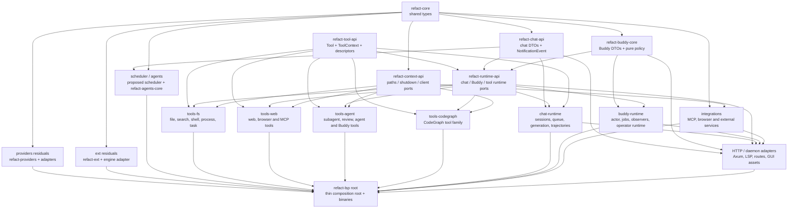

# Refact engine crate-split plan

## Purpose

Turn `refact-lsp` from the engine's implementation container into a thin composition root over crates that Cargo can compile concurrently. This is a staged plan, not a one-shot rewrite: establish API/port boundaries, move coherent implementation families, and leave startup/wiring in the root. Keep stable Rust, preserve normal `cargo build` GUI-asset behavior, and do not add nightly-only parallel frontend flags.

The measured evidence points to broad source volume, not a handful of large function bodies. The root library consumes about 94% of cold-build wall time and starts after its dependencies finish. Its stable-toolchain rustc frontend runs single-threaded. Splitting into independent crates is the remaining meaningful critical-path lever.

## 1. Current state and measurements

### Source LOC

Counted from the current `refact-agent/engine/src` tree. The production count excludes separate `tests.rs` and `*_tests.rs` files and inline `#[cfg(test)] mod ... {}` bodies. Counts are physical source lines, including blanks and comments, so the ratchet is reproducible.

| Measure | Count |
| --- | ---: |
| Rust files under `src/` | 622 |
| Physical lines across those Rust files | 513,062 |
| Separate `tests.rs` files | 3 files / 16,013 lines |
| Separate `*_tests.rs` files | 8 files / 6,006 lines |
| Inline `#[cfg(test)]` modules | 734 blocks / 153,365 lines |
| Production source LOC after exclusions | **337,678** |

### Largest production modules

These per-file counts exclude inline test modules and separate test files; nested files use their Rust module paths.

| Production LOC | Module | Source path |
| ---: | --- | --- |
| 22,133 | `chat::trajectories` | `src/chat/trajectories.rs` |
| 10,402 | `integrations::browser_controller` | `src/integrations/browser_controller.rs` |
| 8,891 | `chat::session` | `src/chat/session.rs` |
| 6,331 | `buddy::operator_store` | `src/buddy/operator_store.rs` |
| 5,726 | `tools::tool_codegraph` | `src/tools/tool_codegraph.rs` |
| 5,223 | `buddy::jobs::autonomous_chats` | `src/buddy/jobs/autonomous_chats.rs` |
| 4,572 | `providers::http` | `src/providers/http.rs` |
| 4,455 | `chat::stream_core` | `src/chat/stream_core.rs` |
| 4,314 | `chat::perf_harness` | `src/chat/perf_harness.rs` |
| 4,051 | `chat::trajectory_index` | `src/chat/trajectory_index.rs` |
| 4,038 | `buddy::actor` | `src/buddy/actor.rs` |
| 3,635 | `chat::generation` | `src/chat/generation.rs` |
| 3,597 | `subchat` | `src/subchat.rs` |
| 3,085 | `files_in_workspace` | `src/files_in_workspace.rs` |
| 3,075 | `http::routers::v1::mcp_marketplace` | `src/http/routers/v1/mcp_marketplace.rs` |
| 3,013 | `tools::design_tools` | `src/tools/design_tools.rs` |
| 2,817 | `tools::tool_chrome` | `src/tools/tool_chrome.rs` |
| 2,749 | `buddy::improvement_artifacts` | `src/buddy/improvement_artifacts.rs` |
| 2,617 | `tools::tool_task_memory` | `src/tools/tool_task_memory.rs` |
| 2,588 | `buddy::memory_lifecycle` | `src/buddy/memory_lifecycle.rs` |

### Module SCCs

A lexical source scan over `use crate::...` statements, resolved to the longest existing Rust module prefix, found 2,468 directed module edges, 539 SCCs, and a **largest use-import SCC of 51 modules** among 610 production modules (separate test files excluded). The 51-module SCC crosses app state, global context, chat, Buddy, HTTP, integrations and tools. Verified members include `src/global_context.rs`, `src/app_state.rs`, `src/chat/trajectories.rs`, `src/chat/prepare.rs`, `src/chat/stream_core.rs`, `src/subchat.rs`, `src/buddy/actor.rs`, `src/integrations/sessions.rs`, `src/http/routers/v1/sidebar.rs`, `src/tools/tools_description.rs`, `src/tools/tools_list.rs`, `src/tools/tool_cat.rs` and `src/tools/tool_tree.rs`.

This scanner undercounts fully qualified paths and macro-generated dependencies; a full `crate::` reference scan over-approximates. Treat 51 as a concrete first-cycle inventory, not proof of acyclicity. Repeat the scan after each port/DTO stage; Cargo metadata is the final DAG authority.

### Compile and incremental measurements

Same-session, back-to-back measurements on 2026-09-30. Each tree got a cold `REFACT_SKIP_GUI_BUILD=1 cargo build --timings`, then a root library `-Z time-passes` run with a single-threaded frontend and non-incremental settings. `-Z` is measurement-only and must not enter project scripts or CI.

| tree | cold build wall | units | root lib unit | time-passes total | MIR borrow checking | mono collector | codegen + LLVM |
| --- | ---: | ---: | ---: | ---: | ---: | ---: | ---: |
| M0 pre-task (`f06830f0b`, Wave 1 reverted) | 956.2 s | 934 | 895.3 s | 717.9 s | 306.8 s | 338.7 s | 39.2 s |
| M1 after Wave 1 (`f06830f0b`) | 923.5 s | 809 | 865.1 s | 647.4 s | 295.6 s | 285.3 s | 43.2 s |
| M2 after Wave 2 (S-1…S-8, S-10; approximately current main) | 877.0 s | 809 | 823.4 s | 637.0 s | 289.5 s | 289.7 s | 33.8 s |

The root unit is about 94% of M2 cold-build wall and starts at approximately 51 seconds after its dependencies. Wave 2's large async-function splits lowered root time-passes only 1.6%; borrow-checking and mono-collection totals barely moved. The cost is distributed across source volume. Root `-Z self-profile` is unusable: measureme panics when its string table exceeds `MAX_USER_VIRTUAL_STRING_ID`.

The one-statement edit experiment at `~/.cache/refact-ct/data/incr/results.txt` records alternating individual `cargo check` runs, generally 13–20 seconds. The merge-tool example showed M1 about 22 seconds versus M2 about 13 seconds; several controls and other sites overlap. The captured file is not a stable complete aggregate, so these are observations, not a claimed mean. The planner's finding is that the incremental floor is about 13–20 seconds whether the edited function is 1,450 lines or 90: fixed per-crate overhead dominates. Any compile-speed claim from splitting must be measured at callers as well as moved modules.

### Existing crates and ports

There are useful seams already: `refact-core` owns common value types; `refact-chat-api` owns chat DTOs/role helpers including `NotificationEvent`; `refact-buddy-core` owns Buddy types/policies; `refact-tool-api` owns descriptors, aliases, argument coercion and command-risk rules. `refact-context-api` provides `ShutdownAccess`, `PathsAccess` and `HttpClientAccess`; `refact-runtime-api` provides runtime sinks, registries and facades. `cargo metadata --no-deps` confirms `refact-runtime-api` depends on chat-api, tool-api, buddy-core and chat-history; API/core crates do not depend on `refact-lsp`.

`GlobalContext` in `src/global_context.rs` is still the composition choke point: provider/model state, paths/files, CodeGraph/VecDB, integration/browser sessions, chat channels/sessions, Buddy state, agent registry, scheduler/hooks configuration and background task coordination. `GlobalContext::app_state()` groups those services into `AppState` in `src/app_state.rs`, but root consumers still cross module boundaries. `Tool` in `src/tools/tools_description.rs` accepts `Arc<AMutex<AtCommandsContext>>`; the context in `src/at_commands/at_commands.rs` stores that global/app state alongside chat/model/task metadata, execution scope, subchat channels, limits, messages, cancellation and privacy/auth state. That concrete parameter pins otherwise independent tool implementations into root.

## 2. Target crate DAG

Solid arrows are compile-time dependencies. Domain crates depend on APIs/ports, never on `refact-lsp`. Root owns composition and adapters. `ToolContext` is a new `refact-tool-api` port. Proposed crate names are explicitly marked where no manifest exists yet.



The DAG is a design boundary, not a report of existing crates. Keep API crates transport-neutral. If actual code needs another edge, introduce a value type or port at the lower layer instead of importing a domain crate upward or pulling `refact-lsp` into a member crate.

## 3. Back-edges to break first

| Edge | Concrete source and move | Resulting boundary |
| --- | --- | --- |
| Global state → HTTP sidebar DTO | `GlobalContext.notification_events_tx` in `src/global_context.rs` names `crate::http::routers::v1::sidebar::NotificationEvent`; `src/app_state.rs` imports that type. `src/http/routers/v1/sidebar.rs` already re-exports `refact_chat_api::notification_event::{NotificationEvent, NotificationQuestion}`, defined in `crates/refact-chat-api/src/notification_event.rs`. | Use the existing chat-api DTO in global/app state and tool senders. Sidebar remains a transport adapter. This is the low-risk first cut. |
| Daemon → HTTP policy request DTO | `preview_operator_policy` in `src/daemon/server.rs` deserializes `crate::http::routers::v1::buddy_observability::PolicyProposal`. It is defined in `src/http/routers/v1/buddy_observability.rs` and embeds `DocumentGrowthPolicy` from `src/buddy/operator_observability.rs`. | Move the proposal and policy DTO to a neutral Buddy API module. Both HTTP and daemon adapters deserialize the same type; auth and mutation remain daemon-owned. Keep serialized shape unchanged. |
| Buddy drafts → runtime/HTTP | `BuddyDraft` and `DraftKind` are in `crates/refact-buddy-core/src/types.rs`, re-exported by `src/buddy/types.rs`. `src/buddy/drafts.rs` owns draft validation/store; consumers include `src/http/routers/v1/buddy_drafts.rs`, `buddy_opportunities.rs`, `customization_editor.rs`, `ext_management.rs`, `src/providers/http.rs`, and `src/tools/tool_buddy_create_draft.rs`. | Keep DTOs in Buddy core; move pure validation only after removing its extensions-runtime dependency; keep storage behind Buddy runtime ports. HTTP/providers are adapters. |
| Buddy runtime → HTTP embedded asset | `src/buddy/improvement_artifacts.rs::running_gui_files` and its digest path call `crate::http::routers::gui::ChatGuiAsset::get`; the private `RustEmbed` type is in `src/http/routers/gui.rs`, and `src/daemon/web.rs` serves it too. | Move asset lookup to a neutral embed-assets adapter or `GuiAssetProvider` port. Buddy receives bytes/digests, never a router type; preserve file list/hash semantics. |
| Cross-domain module edges | `src/global_context.rs` imports agents, app state, providers, exec, integrations, scheduler, voice and knowledge; `src/app_state.rs` assembles services. Chat/Buddy/tools/integrations/daemon use `crate::` references across domains. | Extract shared DTOs and object-safe ports into chat/buddy/tool/runtime/context APIs before moving directories. Use refreshed SCC and Cargo DAG scans after every edge cut; do not duplicate types to evade a cycle. |

The use-import SCC's verified members include `src/global_context.rs`, `src/app_state.rs`, `src/chat/trajectories.rs`, `src/chat/prepare.rs`, `src/chat/stream_core.rs`, `src/subchat.rs`, `src/buddy/actor.rs`, `src/integrations/sessions.rs`, `src/http/routers/v1/sidebar.rs`, `src/tools/tools_description.rs`, `src/tools/tools_list.rs`, `src/tools/tool_cat.rs` and `src/tools/tool_tree.rs`. This is a spot-check, not all 51 modules. Treat extraction as dependency-coherent groups with reverse calls expressed through ports/events, never as blind directory moves.

## 4. `ToolContext` seam

### Contract and observed method inventory

`ToolContext` belongs in `refact-tool-api`; it must not expose `GlobalContext`, `AppState`, Axum or concrete `AtCommandsContext`. Keep the interface object-safe and use API-crate value DTOs. The following sketch separates call metadata from grouped capabilities:

```rust
pub trait ToolContext: Send + Sync {
    fn call(&self) -> ToolCallContext;
    fn workspace(&self) -> &dyn ToolWorkspace;
    fn chat(&self) -> &dyn ToolChat;
    fn runtime(&self) -> &dyn ToolRuntime;
    fn integrations(&self) -> &dyn ToolIntegrations;
    fn agents(&self) -> &dyn ToolAgents;
    fn buddy(&self) -> &dyn ToolBuddy;
    fn tasks(&self) -> &dyn ToolTasks;
}

pub struct ToolCallContext {
    pub chat_id: String,
    pub root_chat_id: String,
    pub current_model: String,
    pub n_ctx: usize,
    pub top_n: usize,
    pub tokens_for_rag: usize,
    pub task: Option<ToolTaskContext>,
    pub background_agent_id: Option<String>,
    pub execution_scope: Option<ToolExecutionScope>,
    pub tool_access_bypass: bool,
    pub subchat_depth: usize,
}

#[async_trait::async_trait]
pub trait ToolChat: Send + Sync {
    async fn get_goal(&self, chat_id: &str) -> Result<Option<GoalSnapshot>, String>;
    async fn get_plan(&self, chat_id: &str) -> Result<Option<String>, String>;
    async fn save_trajectory(&self, chat_id: &str) -> Result<(), String>;
    async fn send_notification(&self, event: NotificationEvent) -> Result<(), String>;
}

#[async_trait::async_trait]
pub trait ToolRuntime: Send + Sync {
    async fn process_start(&self, request: ToolProcessStart) -> Result<ToolProcessSnapshot, String>;
    async fn process_read(&self, id: &str, since_seq: u64) -> Result<ToolProcessRead, String>;
    async fn process_control(&self, id: &str, action: ToolProcessAction) -> Result<ToolProcessSnapshot, String>;
    async fn shell(&self, request: ToolShellRequest) -> Result<ToolShellResult, String>;
    async fn cron(&self, request: ToolCronRequest) -> Result<ToolCronResult, String>;
}
```

`Tool*` DTOs in that sketch are proposed type names, not existing symbols. Define them in `refact-tool-api` or a runtime API crate before adoption. Existing reusable process types include `ExecSpawnRequest`, `ExecProcessSnapshot` and `ExecReadResult` from `refact-exec`; expose/reuse those through the runtime API or define explicit adapters instead of duplicating semantics. `GoalSnapshot` and `TaskMeta` already live in `refact-chat-api`; `NotificationEvent` lives there too. `ContextEnum`/`ContextFile` are in `refact-core::chat_types`. `SubchatParameters` remains in `src/call_validation.rs` and must move before an API signature uses it.

The call context inventory from `src/at_commands/at_commands.rs` is: chat/root IDs, model, task metadata, background agent, execution scope, context limits, RAG token budget, messages, subchat depth, tool-access bypass, cancellation, subchat channels/parameters, postprocess settings, activity stamp, privacy provenance and supervised-edit authorization. A direct grep of tool sources found `ccx.app` (15 references), `ccx.chat_id` (9), `ccx.execution_scope` (5), `ccx.background_agent_id` (3), `ccx.root_chat_id` / `ccx.current_model` (2 each), and `ccx.global_context`, `task_meta`, `top_n`, `tool_access_bypass`, `execution_scope_worktree()` (one each), plus 206 `ccx.lock()` and 109 `ccx.clone()` occurrences. Local lock-guard aliases mean this is only a starting inventory: each family migration must inspect its locked service reads.

Capability grouping derived from the implementations:

- **Workspace/files:** workspace roots/scope, path resolution, read/tree/search/definition, CodeGraph/VecDB lookup and guarded edits. Consumers include `src/tools/tool_cat.rs`, `tool_search.rs`, `tool_tree.rs`, `tool_ast_definition.rs`, `tool_regex_search.rs`, `tool_glob.rs`, and `src/tools/file_edit/`.
- **Chat:** session/goal/plan access, trajectory save, notifications and event emission. Examples: `src/tools/tool_get_goal.rs`, `tool_get_plan.rs`, `tool_set_trajectory_label.rs`, `tool_task_done.rs`, `tool_ask_questions.rs`.
- **Runtime/processes:** process lifecycle/transcripts, shell policy/config, cron, sleep/tick, shutdown/cancellation. Examples: `src/tools/tool_process.rs`, `tool_process_subscribe.rs`, `tool_process_write_stdin.rs`, `tool_shell.rs`, `tool_sleep.rs`, and `tool_cron_*.rs`.
- **Model/retrieval:** model/caps/provider queries, codegraph, VecDB, knowledge, memory/enrichment. `src/tools/tool_codegraph.rs` reads `top_n`, execution scope and app CodeGraph state.
- **Integrations/agents/tasks/Buddy:** integration/browser sessions, agent registry and messaging, task board/documents, Buddy activity/events/memory/preferences/drafts/speech.

No method returns a generic `GlobalContext`/`AppState` handle. The root adapter implements these ports over current grouped service handles; domain tools keep decisions and result formatting. The `Tool` trait's current result remains `(bool, Vec<ContextEnum>)` during extraction.

### Incremental adaptation

1. Add the `ToolContext` contract, call DTO and capability interfaces to `refact-tool-api`, independently of `refact-runtime-api` (runtime-api already depends on tool-api). Move `Tool` only when its execution argument no longer names root `AtCommandsContext` or a root-only result type.
2. Implement one private root adapter over `AtCommandsContext`/`AppState`/`GlobalContext`; retain tool registration, schemas and confirmation policy.
3. Port read/search and file-edit tools first, then web/browser, CodeGraph, task/agent and Buddy families. Use a short-lived forwarding shim to adapt legacy calls; delete it when a family has no root context imports.
4. After the final family, change `tool_execute` to receive the trait-object port and remove `Arc<AMutex<AtCommandsContext>>` from the common `Tool` contract. Run tests and cross-crate API checks at each family boundary.

Do not wrap `AtCommandsContext` in a newtype in tool-api: that merely renames the root dependency. Keep `ContextEnum`/`ContextFile` in refact-core initially unless separate API evidence justifies moving them. Add explicit operations for abort, subchat parameters/channels, postprocess settings, activity stamping, privacy provenance and supervised-edit checks where a family uses them.

### Test helper plan

There are **712 textual `make_test_gcx()` occurrences** under `src/`, including the definition and call sites. `make_test_gcx()` and `make_test_gcx_with_dirs()` are in `src/global_context.rs`'s `global_context::tests`; they construct the full engine.

- Keep the helper root-only while tests still need full engine adapters.
- Move tests with implementations when they can use small crate-local port fakes. Prefer per-port fake workspace/chat/runtime fixtures over another all-purpose engine context.
- Add a dev-only `refact-test-support` crate only for genuinely shared fixtures; depend on API types/ports, never `refact-lsp`. Keep `GlobalContext` construction in root tests.
- Migrate high-count users in batches and count remaining references; delete the helper only when none remain. Compile domain tests without production adapters where Cargo targets permit.

Important existing dependency: `refact-buddy-core` currently depends on `refact-ext` because `crates/refact-buddy-core/src/drafts.rs` calls `refact_ext::slash_commands::parse_frontmatter_and_body`. Extract that parser into a neutral text/config API before treating Buddy core as independent of extension runtime.

## 5. Migration order

Scope estimates use the production LOC from §1. At each stage, take the same paired measurement: cold `REFACT_SKIP_GUI_BUILD=1 cargo build --timings` and the non-incremental root-lib `-Z time-passes` protocol on the same session/host. Record commit, Rust version, load, root unit, timing components and Cargo critical path. Also compare incremental one-statement edits in moved modules and caller controls; cold timings are the primary criterion.

| # / stage | Scope / existing source and approximate root LOC | Prerequisites | Acceptance criteria | Measurement and expected effect | Rollback |
| --- | --- | --- | --- | --- | --- |
| 1. Providers, extensions, scheduler and agents residuals | `src/providers/` ~6.5k →/behind `refact-providers`; `src/ext/` ~10.5k → `refact-ext`; `src/scheduler/` ~4.0k → proposed scheduler crate; remaining `src/agents/` ~1.9k → `refact-agents-core`. Reconcile existing mirrors, do not duplicate them. | Shared model/provider/config/event DTOs and context/runtime ports identified. Extract the `refact-ext` slash-command parser currently used by `refact-buddy-core`. | No member crate depends on root; provider config/IDs, scheduler fire/retry/shutdown and agent lifecycle unchanged; tests pass; Cargo metadata acyclic; each moved area compiles independently. | About 23k root LOC. Expected cold critical-path effect 0–5% alone; value is reducing root edges/invalidation for later stages. Measure even if wall change is small. | Revert this stage's file/manifest moves only; retain new DTO crates if consumed elsewhere. |
| 2. Tool families | `src/tools/` ~68.5k into `tools-fs`, `tools-web`, `tools-agent`, `tools-codegraph`; includes `src/tools/file_edit/` (~3.2k), `tool_codegraph.rs` (~5.7k), `tool_chrome.rs` (~2.8k), `design_tools.rs` (~3.0k), task, shell/process and Buddy tools. `src/at_commands/` is ~2.9k and moves only with its own ports. | `ToolContext` adapter exists; notification and draft DTO crossings are cut. Split by capability, not file prefixes alone. | Tool names/schemas/confirmation, cancellation, worktree/privacy scopes, `ContextEnum` ordering and API behavior preserved; each family has no root dependency; tests use port fakes; registry remains root composition. | Largest single removal (~20% of source). Expected cold critical-path effect roughly 5–15% alone; chat/root chains remain. Recheck caller incremental edits. | Revert one family to root re-exports; preserve stable descriptors/API DTOs. |
| 3. Chat runtime | `src/chat/` ~72.1k, `src/subchat.rs` ~3.6k, chat-specific `src/trajectory_memos.rs` → proposed `refact-chat-runtime`. Keep HTTP/LSP transports and startup outside. | Chat API/history contracts and runtime ports stable; `Tool` no longer exposes root `AtCommandsContext`; notification DTO already in chat-api. | Trajectory/wire shapes, event sequence/order, locks/cancellation/shutdown, tool scheduling and provider requests unchanged; chat runtime has no root dependency; all chat tests pass. | Chat is ~21% of source and likely the largest domain chain. Root lib reduction becomes material only after callers also move; estimate from actual Cargo timings, not LOC division. | Keep compatibility root re-exports; revert facade binding and manifest edge without duplicate source. |
| 4. Buddy runtime | Runtime portions of `src/buddy/` ~57.9k: actor, jobs, observers, scheduler, storage and operator services → proposed `buddy-runtime`; pure DTO/policy stays in `refact-buddy-core`. | Policy proposal, drafts/events/assets no longer depend on HTTP/router; ext parser dependency removed; ToolContext/chat/runtime/filesystem ports available. | Persisted schemas, legacy migration, actor order/backpressure, cadence, authority and shutdown semantics unchanged; runtime crate depends only on lower API/core crates. | ~17% of production LOC; can compile alongside chat after API stabilization. Expected additional critical-path reduction roughly 5–12%, dependent on one-way dependencies. | Leave buddy-core intact; revert runtime move/facade only. |
| 5. Integrations | Remaining `src/integrations/` ~24.6k to `refact-integrations` and existing focused crates; `browser_controller.rs` ~10.4k. | Tool/Buddy/chat use integration ports; protocol models separated from engine configuration/session ownership. Audit root mirrors against `refact-browser` and `refact-integrations` to avoid duplicate implementations. | Registration/settings/secrets, browser/MCP protocol, cancellation and lifecycle unchanged; no `GlobalContext` reach-through; one source of truth. | ~7% of source; usually a parallel branch. Expected critical-path effect 0–8%; root invalidation/fan-in may improve more than wall time. | Switch factories to previous adapters; revert the dependency edge without removing shared protocol DTOs. |
| 6. HTTP and daemon adapters | `src/http/` ~36.4k and `src/daemon/` ~15.2k into adapter crates as routes/assets/LSP dependencies allow; root retains startup assembly and `main.rs`/`bin/refact.rs`. | DTO/back-edge list clean; service operations behind runtime/context ports; domains do not import HTTP; router builders take facades. | Route/method/status/body/header, daemon auth/lifecycle/proxy, GUI asset hash and LSP contracts preserved; route inventory matches; HTTP/daemon tests pass; adapters do not depend on root. | ~51.6k source. Potential 10–20% reduction of root unit if adapters do not retain domain code; measure and identify new longest chain. | Preserve root `make_router`/serve wrappers; reverse adapter selection and restore route module paths. |
| 7. Thin composition root | Remaining `src/` becomes startup, dependency wiring, binaries and small adapters; move business code only where an established port owns dependencies. | Prior stages independently pass; DAG acyclic; public crate/bin compatibility re-exports in place. | Ratchet lowers; no large tool/chat/Buddy/provider/integration implementation remains in root; supported `refact-lsp`, `refact` and TUI targets plus engine tests/docs pass. | Fresh same-session cold/timing A/B against M2; compare observed wall with longest Cargo chain and report host load/components. | Revert only the latest domain move to its last passing boundary; preserve ports and stable DTOs. |

The order is deliberate: service residuals → tool families → chat runtime → Buddy runtime → integrations → HTTP/daemon adapters → thin root. Subdivide into independently testable commits, but do not move a later domain ahead of its ports or erase the named boundaries.

## 6. Root LOC ratchet

Add `refact-agent/engine/tools/check_root_src_loc.py` and `refact-agent/engine/tools/root_src_loc_limit.txt`. The Python checker counts Rust lines below `src/`, excluding standalone `tests.rs`, `*_tests.rs`, and inline `#[cfg(test)] mod` blocks using the same lexical rule as §1. Initial checked-in ceiling: **337678**. Keep script and limit outside `src/` so they do not inflate the measured root.

The planned CI workflow is `.github/workflows/agent_engine_check.yml`, owned by K-1. Add a Python checker step from repository root; no Cargo build is required. Fail when actual production LOC exceeds the limit; report actual, limit and delta. This ratchet guards root growth and does not replace compile/test jobs.

Update procedure:

1. A move must delete old root source; adding a crate without transferring ownership earns no reduction.
2. Run the checker locally and compare its result with `git diff --stat`/`--name-status`.
3. Lower the checked-in ceiling to the exact new count only after the stage's checks/tests and measurement pass. The number may stay unchanged mid-migration but **may only go down, never up**.
4. If actual is lower after another valid cleanup, lower the ceiling in the same reviewed change. If source grows, remove the root implementation or leave the ceiling and fail CI; never raise it to get green.

K-1 adds the workflow; this plan specifies the future checker step only. Do not add a competing workflow or implement CI as part of this plan.

## 7. Critical-path estimate and risks

### Estimate

M2's root unit is 823.4 seconds of effectively serial frontend work. Cargo can overlap independent crate units but not a dependency chain. First-order model, to update once per-crate timings exist:

`critical path ≈ max over dependency chains of Σ (823.4 s × crate production LOC / 337,678 root production LOC)`

Linear LOC scaling is approximate; macros, generics/monomorphization, features and test cfgs change per-line costs. A plausible first split leaves 15–25% of semantic compile work in adapters/root and gives the API + largest domain + adapter chain roughly 40–50% of today's normalized work. That suggests **450–620 seconds** for the root-library-related critical path versus 823 seconds now (about 25–45% lower), not an order-of-magnitude claim. If tools/chat become serialized or the root retains large generic call sites, results can be near the upper bound or barely improve. Total cold build may improve less because dependencies already compile in parallel and linker/build-script work remains. Replace the estimate with actual Cargo timing-chain data after every stage; report load and a range, not a promised second count.

### Risks and mitigations

- **Feature unification:** optional features may leak into unrelated builds. Keep features explicit, preserve default `voice`, inspect `cargo tree -e features -p refact-lsp`, compare feature/unit sets per stage.
- **Windows builds:** process, path, registry, filesystem and browser code has platform cfgs. Run supported Windows CI targets after moves; do not make Linux path behavior the only implementation.
- **Tests tied to GlobalContext:** 712 helper occurrences can preserve root coupling. Move tests with implementations, use port fakes, and keep engine-construction tests at root. Track references before deleting the helper.
- **Incremental-compile regressions:** the 13–20s floor is largely fixed per-crate overhead. More crates may add metadata/manifest costs; alternate edits in moved modules and caller controls before claiming improvement.
- **TUI/binary public API churn:** `refact-tui`, `refact`, `refact-lsp` are workspace consumers. Preserve public re-exports, CLI and wire DTOs; inspect `cargo metadata` targets and compile all relevant bins/tests at transition points.
- **Orphan rules / impl placement:** moving a trait/type may invalidate downstream impls. Place traits with ports and impls with the concrete type's crate or local adapter/newtype; avoid duplicate DTOs and blanket impls.
- **SCC/dependency cycles:** no domain crate may depend back on root. Cut DTO/service edges first; keep event/environment/config assembly at root.
- **Crate count / duplicate dependencies:** more crates do not guarantee speed if the DAG gets deep. Prefer coherent family crates; inspect actual Cargo critical path and dependency duplication each stage.
- **Public behavior:** serializers, SSE sequencing, lock/cancel/shutdown order, privacy gates, process teardown and tool confirmation are contracts. Add boundary/serialization tests before each move.
